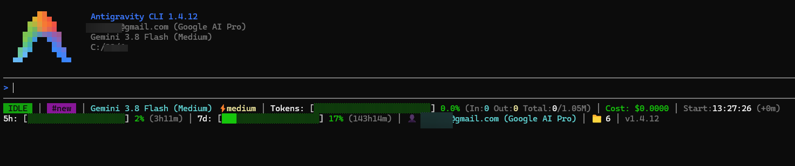
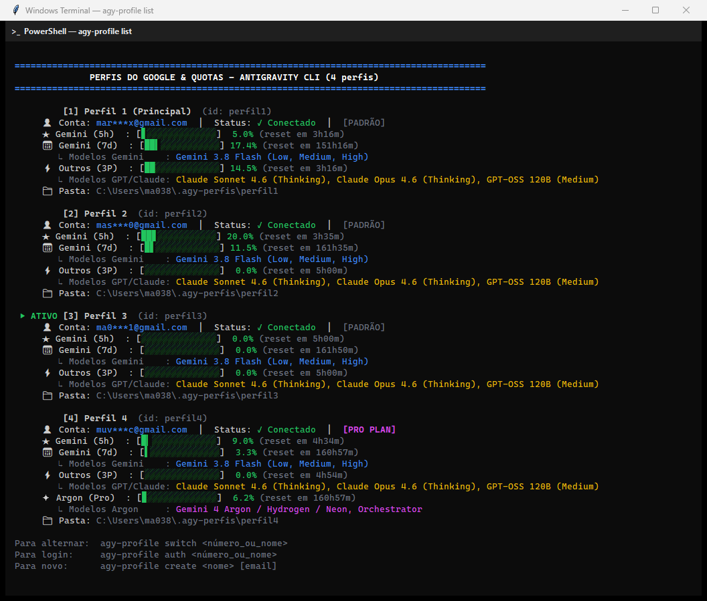
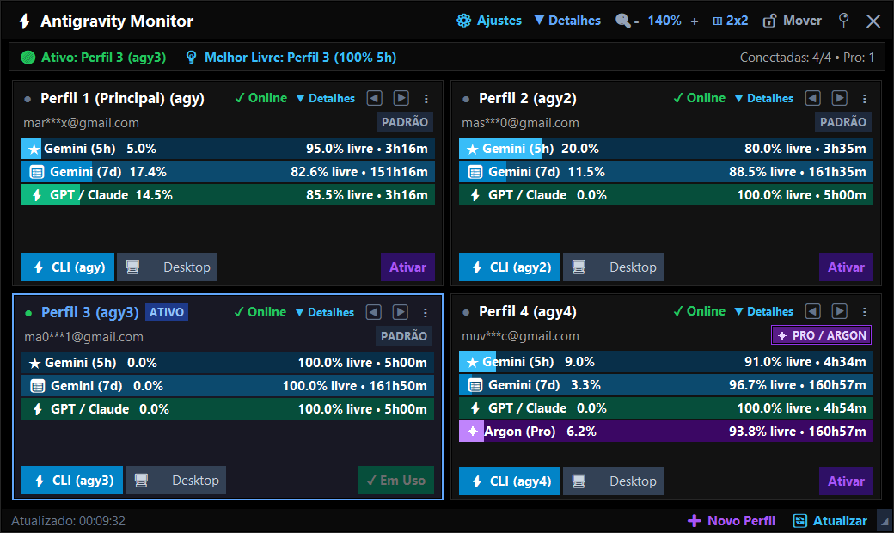

# Antigravity CLI Toolbar (`agy-cli-toolbar`)

[](https://www.python.org/)
[](LICENSE)
[](https://github.com/marceloasl99/agy-cli-toolbar)
[](https://github.com/marceloasl99/agy-cli-toolbar)

> 🇧🇷 **Versão em Português:** Para ler a documentação completa em Português do Brasil, acesse o [README.pt-BR.md](README.pt-BR.md).

A pure Python, high-performance telemetry, real-time quota monitor, and multi-account workspace manager for the **Google Antigravity CLI (`agy`)**. It offers two complementary experiences:

1. **CLI Experience (`statusline.py` + `agy-profile`)** — An ultra-fast, adaptive **3-Line Executive Statusline** for terminal environments (Windows Terminal, PowerShell, CMD, Bash, Zsh) with sub-character smooth progress bars, token economics, and multi-profile account isolation.
2. **Windows Desktop Experience (`tray_app.pyw`)** — A native desktop HUD widget and system tray app with responsive auto-fitting grids (`2x2`, `3x2`, `Auto`), strict screen-bound clamping, in-bar gauges, and hover tooltips detailing model quotas.

---

## 📊 Official Quota Architecture & Model Families

The Antigravity CLI Toolbar mirrors the exact telemetry and rate-limit pools reported by the official Google Antigravity engine:

| Quota Pool | Telemetry Key | Exact Covered Models | Plan Availability |
| :--- | :--- | :--- | :--- |
| **★ Gemini (5h & 7d)** | `gemini-5h`, `gemini-weekly` | `Gemini 3.8 Flash (Low)`, `Gemini 3.8 Flash (Medium)`, `Gemini 3.8 Flash (High)` | Standard & Pro |
| **⚡ GPT / Claude (Other 3P)** | `3p-5h`, `3p-weekly` | **Standard:** `Claude Sonnet 4.6 (Thinking)`, `Claude Opus 4.6 (Thinking)`, `GPT-OSS 120B (Medium)`<br>**Pro:** `Claude Sonnet 5.5`, `Claude Opus 5.5`, `GPT-OSS 120B (Medium)` | Standard & Pro |
| **✦ Argon (Weekly WTU)** | `gemini-argon-wtu-weekly` | `Gemini 4 Argon (Low/Med/High)`, `Gemini 4 Hydrogen (Low/Med/High/XHigh)`, `Gemini 4 Neon (Low/Med/High/XHigh)`, `Orchestrator (Neon / Argon)` | **Pro Plan Exclusive** *(automatically hidden on Standard plans)* |

---

## 1️⃣ CLI Experience: 3-Line Executive Statusline

Engineered in **pure Python with zero external dependencies and sub-10ms render latency**, featuring sub-character 1/8th smooth block rendering (`▏`, `▎`, `▍`, `▌`, `▋`, `▊`, `▉`, `█`).

### 📸 Terminal Previews

#### Antigravity CLI 3-Line Statusline in Action

> *Live terminal capture showing the 3-line statusline rendering reasoning state, token economics, rolling quotas, subagent swarms, and system health.*

#### Multi-Profile & Quota Terminal Overview (`agy-profile list`)

> *Colorized terminal view displaying isolated Google accounts, OAuth status, quota bars per model family, and exact model coverage.*

---

### 🔍 3-Line Terminal Architecture

```text
[ IDLE ]  │ #29bfb6f9 "My Project" │ ✦ Gemini 3.8 Flash ⚡medium [auto] │ Tokens: [██████▍░░░░░░░░░░░░░░░░░] 26.8% (In:165.0k Out:12.4k ⚡cache:54.0k Total:177.4k/1.05M) │ Cost: $0.1399 (Saved $0.0304) │ ⏱ 45m
5h: [█████▎░░░░░░░░░░░░░░] 26% (reset 2h43m) │ 7d: [██▍░░░░░░░░░░░░░░░░░] 12% (120h) │ 🟢 Safe Pace │ 👤 user@example.com [Pro] │ 🤖 Subagents (1): researcher │ ⚙️ Tasks:1 │ 📄 Docs:4
🧠 RAM: [████▌░░░] 56%/23G │ 🖥️ Windows │ 📁 agy-cli-toolbar │ git:main* +1-0 │ 🔌 MCP:3 active │ ⚡ Skills:8 │ 🛡️ Sandbox:ON │ 🕒 11:15:00 │ agy v1.4.12 • Py3.14
```

* **Line 1 — Agent Lifecycle, Model & Token Economics:**
  * Real-time lifecycle badge (`IDLE`, `THINKING`, `TOOL USE`).
  * Conversation identifier (`#29bfb6f9`) and project title.
  * Active model family, thinking effort level (`⚡low`, `⚡medium`, `⚡high`), and execution mode (`[auto]`).
  * 24-character context saturation gauge with `[>200k]` overflow indicator.
  * Exact token breakdown: Input, Output, and Prompt Cache hits.
  * Estimated commercial API session cost (USD) + prompt cache savings.
  * Live generation velocity (`tokens/sec`) and elapsed session timer.

* **Line 2 — Rate-Limit Quota Pools, Velocity & Swarm Telemetry:**
  * Rolling **5-hour** and **7-day weekly** quota saturation bars with exact reset countdowns.
  * Dynamic quota burn rate indicator (`🟢 Safe Pace` vs `🔥 Burn: X%/h`).
  * Active Google profile identifier, authenticated email, and plan tier (`[Pro]` / `[Standard]`).
  * Active autonomous subagent swarm monitor (`🤖 Subagents (N)`).
  * Background async task counter and generated artifact/document tally.
  * Auto-syncs live quota metrics to `~/.antigravity-custom/profiles_quotas.json`.

* **Line 3 — System Health, Workspace & Tooling Engine:**
  * Host RAM memory utilization gauge (`🧠 RAM: [████▌░░░] 56%/23G`) via native OS calls.
  * Host OS identifier and active project workspace directory.
  * Git VCS status: active branch, dirty state (`*`), and ahead/behind commit diffs (`+1-0`).
  * Connected Model Context Protocol (MCP) servers count.
  * Registered Antigravity agent skills count.
  * Security sandbox containment status (`🛡️ Sandbox:ON`).
  * Real-time 24-hour local clock and Python/runtime version tags.

* **Adaptive Responsiveness:**
  * Automatically switches layouts based on terminal width: Wide (`>= 140` cols), Medium (`100–139` cols), and Compact Split-Pane (`< 100` cols).

---

### 👥 Multi-Profile Account Isolation (`agy-profile`)

Isolates individual Google accounts into dedicated sandboxes (`~/.agy-perfis/perfil1`, `perfil2`, `perfil3`, `perfil4`, `agy5`, `agy6`...) without token collisions or session cross-contamination.

> **Important:** Use `agy1`, `agy2`, ..., `agy6` to launch isolated profiles (`agy` invokes the native raw CLI binary directly). Because Antigravity CLI stores its active session token in a single Windows Credential Manager slot, each profile binds its expected email in `profile_identity.json` — `pre-run` swaps tokens only for that identity and `post-run` refuses to save a mismatched account. Running profiles sequentially (one at a time) is safest; launching two different profiles simultaneously shares that single credential slot during startup.

| Command | Action |
| :--- | :--- |
| `agy-profile` | Opens interactive terminal menu for managing accounts |
| `agy-profile list` | Lists all accounts, OAuth connection states, quotas, and model coverage |
| `agy-profile switch <num\|id>` | Switches the active system profile and synchronizes credentials |
| `agy-profile create <name> [email]` | Creates a new sandboxed profile with `.gemini`, `settings.json`, and dedicated CLI launchers |
| `agy-profile auth <num\|id>` | Triggers **OAuth 2.0 PKCE** browser login or Desktop 1-Click login |
| `agy-profile doctor [--fix]` | Audits credential bindings across all profiles and repairs duplicate/contaminated accounts |
| `agy-profile reset-auth <num\|id>` | Quarantines saved auth files for a profile so it prompts for a fresh login |
| `agy-profile bind <perfil> <email>` | Manually binds a profile to an expected Google account email |
| `agy-profile capture <perfil>` | Saves the currently active Windows session into the specified profile |
| `agy-profile share-sessions` | Ensures unified conversation history & `/resume` junctions across all profiles |
| `agy-profile launchers` | Regenerates canonical `agy1.cmd`..`agyN.cmd` launchers and cleans stale wrappers |
| `agy-profile desktop <num\|id>` | Launches isolated **Antigravity Desktop** (`--user-data-dir`) for selected profile |
| `agy-profile run <num\|id> [args]` | Runs `agy` CLI inside the sandboxed environment of the specified profile |
| `agy-profile delete <num\|id>` | Safely deletes an extra profile and removes its launcher scripts |
| `agy-profile tray` *(or `agy-tray`)* | Starts the Windows Tray & Floating Dashboard HUD |
| `agy-profile autostart on\|off` | Toggles automatic silent launch on Windows startup |

---

### 🔄 Seamless Cross-Profile `/resume` & `--continue`

You can start a project in **`agy2`**, run out of quota, and immediately switch to **`agy4`** (or any profile) to pick up **exactly where you left off**:

```bash
# Started work in perfil2:
C:\Projects\myapp> agy2
# (token / quota runs out; exit)

# Seamlessly continue in perfil4:
C:\Projects\myapp> agy4 -c
# OR
C:\Projects\myapp> agy4
/resume
```

**How it works under the hood (Dual-Layer Shared Sessions):**
- **Unified Sessions Storage:** `conversation_summaries.db`, `conversations/*.db`, `brain/`, and `history.jsonl` are shared via NTFS Directory Junctions (`mklink /J`) pointing to `%USER_HOME%\.gemini\antigravity-cli`.
- **100% Strict Credential Isolation:** Authentication tokens (`wincred.json`, `google_accounts.json`, `profile_identity.json`) remain strictly private to each profile directory (`%PERFIL_ROOT%\.gemini\`), guaranteeing zero account cross-contamination while sharing project conversation state.

---

### 📂 Trusted Working Directory (`agy-profile workdir`)

Each profile can have one or more **trusted working directories** (project folders). Whenever you set, add, or select a folder in the launcher picker, it is also registered under `trustedWorkspaces` in that profile's `settings.json`, and the CLI automatically `cd`s into it on launch.

```bash
# Set the default folder for a profile (opens in this dir every time)
agy-profile workdir set perfil1 C:\Projects\myapp

# Add an extra folder without changing the default
agy-profile workdir add perfil1 C:\Projects\other

# List all configured folders
agy-profile workdir list
agy-profile workdir list perfil1

# Interactive picker — choose which folder to open
agy-profile workdir choose perfil1

# Remove a configured folder
agy-profile workdir remove perfil1 C:\Projects\other

# Output path only
agy-profile workdir get perfil1
```

Configured folders are stored in `~/.antigravity-custom/profile_workdirs.json`.

---

### 🚀 Launch Options: Default Folder + Permission Mode (`agy-profile launch`)

Before `agy.exe` starts, each profile launcher (`agy1`..`agyN`) can open an interactive pre-launch picker to confirm or override the **working directory** and **permission mode** (stored in `~/.antigravity-custom/profile_launch.json`).

```bash
# View launch settings for all profiles (or a specific one)
agy-profile launch show [profile]

# Set default permission preset (shortcut: agy-profile perm <profile> <preset>)
agy-profile launch perm perfil1 all
agy-profile perm agy5 auto

# Toggle interactive picker on launch (on | off)
agy-profile launch ask perfil1 off

# Open the interactive configurator and save defaults
agy-profile launch config perfil1
```

**Permission Presets:**

| Preset | Description | CLI Flag Passed |
| :--- | :--- | :--- |
| `default` | Ask before each action *(default)* | *(none)* |
| `accept-edits` | Auto-accept file edits | `--mode accept-edits` |
| `auto` | Automatic execution mode | `--mode auto` |
| `plan` | Planning mode only | `--mode plan` |
| `all` *(aliases: `todas`, `skip`)* | **All permissions (no prompts)** | `--dangerously-skip-permissions` |
| `sandbox` | Restricted terminal sandbox | `--sandbox` |

**Interactive Picker Keys:**

* `Enter` — Launch with current folder and permission
* `P` — Pick from saved folders, current directory (`A`), or enter a new path (`N`)
* `M` — Pick permission preset
* `S` — Save current folder & permission as the profile default
* `D` — Disable the picker for this profile (`ask_on_launch = false`) and launch
* `0` — Cancel launch

> **Automation tip:** Set `AGY_NO_PICKER=1` (or pass explicit flags like `--mode plan` / `--dangerously-skip-permissions`) to bypass the interactive picker without changing your saved `ask_on_launch` preference.

**How it works at launch:**

```
agy5 ──► pre-run hook (swap creds + launch picker) ──► cd to folder ──► agy.exe [perm args] ──► post-run hook (guarded save)
```

---

## 2️⃣ Windows Experience: Floating Dashboard & System Tray (`tray_app.pyw`)

A native, zero-console background application (`pythonw.exe`) combining a custom **Floating Desktop HUD** with a **Windows System Tray** controller (`pystray`).

### 📸 Windows Desktop Previews

#### Floating HUD — Compact In-Bar View

> *Symmetric grid with Executive KPI Strip, in-bar percentage & reset countdowns, active profile highlight, and automatic Argon hiding on standard plans.*

#### Floating HUD — Expanded Model Breakdown Drawer

> *Expanded view (`▼ Detalhes`) displaying the exact model coverage of each quota pool directly inside the profile cards.*

#### Advanced Settings Center (`⚙️ Ajustes`)

> *Unified 880x640 configuration center with smooth vertical scrolling across all 5 preference categories.*

---

### 🔍 Windows Architecture Highlights

* **Adaptive Auto-Fit & Screen Clamp (Never Exceeds Resolution):**
  * Window dimensions (`width` and `height`) are strictly clamped to your screen resolution (`max_w = screen_w - 40`, `max_h = screen_h - 70`).
  * The **`⛶ Fit`** button and **`Auto`** preset dynamically calculate the optimal zoom scale (`ui_scale`) and dimensions to ensure cards never overflow or get cut off.
* **Instant 4-Profile / All-Profile Toggle:**
  * Quick header button: switch seamlessly between **`🎯 4 Perfis (2x2)`** and **`⊞ Todos (3x2)`** with a single click.
* **Ultra-Compact In-Bar Gauges & Fast 2s Monitoring:**
  * Watches `profiles_quotas.json` every 2 seconds to immediately reflect quota usage recorded by `statusline.py`.
  * Displays `% used`, `% free`, and reset countdown right inside the bar track.
* **Dynamic Hover Tooltips:**
  * Hovering over any quota bar pops up a styled tooltip detailing the exact model list, remaining percentage, and reset time.
* **Executive KPI Strip:**
  * Displays the current active profile, total connected accounts, Pro plans, and the **`💡 Melhor Livre`** one-click shortcut to switch to the account with the highest free quota.
* **Context Menu (`⋮` or Right Click):**
  * Direct card actions: launch CLI terminal (`⚡ CLI (agyN)`), launch Desktop app, switch active account, toggle detailed view, rename nickname, or open profile folder.
* **Themes & Personalization:**
  * 4 dark themes (`Dark Slate`, `Midnight OLED`, `Cyberpunk Neon`, `Emerald Tech`).
  * Zoom scaling (`75%` to `200%`), font size offsets, opacity slider (`60%` to `100%`), and Privacy Mode (masks emails for recording/streaming).
* **Single Instance & IPC Socket:**
  * Win32 Named Mutex paired with a local IPC TCP socket (`127.0.0.1:49285`) ensures clicking desktop shortcuts instantly focuses the existing HUD without duplicate processes.

---

## ⚖️ Feature Comparison: CLI vs. Windows Experience

| Feature | CLI Experience (`statusline.py` / `agy-profile`) | Windows Experience (`tray_app.pyw`) |
| :--- | :--- | :--- |
| **Execution Context** | Inside terminal (`agy` CLI / PowerShell / Bash / Zsh) | Native Windows Desktop + System Tray |
| **Supported OS** | Windows, Linux, and macOS | Windows 10 / 11 |
| **Primary Purpose** | Real-time session telemetry (tokens, cost, TPS, RAM, Git) | Multi-account overview, consolidated quotas, and quick launch |
| **Update Mechanism** | Reads live engine `stdin` during session execution | Polls `profiles_quotas.json` every 2s with in-place UI updates |
| **Dependencies** | Python 3.8+ (Standard Library only) | Python 3.8+, `pystray`, `Pillow`, `tkinter` |

---

## 🛠️ Installation

### Option 1: 1-Click Automated Installer (Recommended)

#### Windows (PowerShell — Installs CLI + Windows Tray/HUD + Desktop Shortcut):
```powershell
irm https://raw.githubusercontent.com/marceloasl99/agy-cli-toolbar/main/install.ps1 | iex
```

#### Linux / macOS (Bash — Installs CLI Experience):
```bash
curl -fsSL https://raw.githubusercontent.com/marceloasl99/agy-cli-toolbar/main/install.sh | bash
```

---

### Option 2: Manual Installation (CLI Experience)

1. Create directory `~/.antigravity-custom` and copy `statusline.py` and `profile_manager.py` into it.
2. Edit your Antigravity CLI configuration file:
   * **Windows:** `%USERPROFILE%\.gemini\antigravity-cli\settings.json`
   * **Linux/macOS:** `~/.gemini/antigravity-cli/settings.json`
3. Add or update the `statusLine` block:

```json
{
  "statusLine": {
    "type": "command",
    "command": "python ~/.antigravity-custom/statusline.py",
    "padding": 0,
    "stack_with_default": false,
    "enabled": true
  }
}
```

---

## ⚙️ Configuration (`config.json`)

Customize themes and telemetry toggles by placing a `config.json` inside `~/.antigravity-custom/`:

```json
{
  "theme": "default",
  "nerd_fonts": false,
  "smooth_bars": true,
  "show_line3": true,
  "show_cost": true,
  "show_tokens_per_sec": true,
  "show_quota_5h": true,
  "show_quota_weekly": true,
  "show_burn_rate": true,
  "show_subagents": true,
  "show_tasks": true,
  "show_artifacts": true,
  "show_email": true,
  "show_profile": true,
  "show_ram": true,
  "show_workspace": true,
  "show_git": true,
  "show_mcp": true,
  "show_skills": true,
  "show_sandbox": true,
  "show_clock": true,
  "show_version": true
}
```

* **Themes available:** `default`, `tokyo_night`, `catppuccin`, `nord`, `cyberpunk`, `plain`.

---

## 📄 License

Distributed under the **MIT License**. Free for personal and commercial use.
Created for the **Google Antigravity** community.
