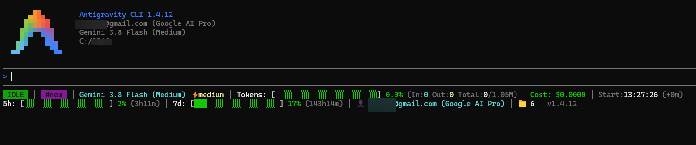

# Antigravity CLI Toolbar (`agy-cli-toolbar`)

An advanced, adaptive **2-line status bar** (responsive across Full HD, medium, and narrow split panes) for the **Google Antigravity CLI (`agy`)**.

Built in **Pure Python (Zero runtime dependencies)** with double-sized 20-block quota gauges, terminal auto-resizing, token speed (tokens/sec), prompt caching discounts, dynamic API cost estimation in USD, rolling 5-hour & weekly quota countdowns, subagents, background jobs, themes, and automated 1-click installation.

---

## 📸 Real Terminal Preview



> *Real terminal capture of Google Antigravity CLI v1.4.12 running on Windows with `agy-cli-toolbar` active.*

---

## 🌟 Why Use `agy-cli-toolbar`?

By default, the Antigravity CLI provides minimal status feedback. Alternative statusbars often require Node.js runtimes, wrap awkwardly on narrower screens, or lack critical financial and rate-limit insights.

`agy-cli-toolbar` is:
* **Zero Dependencies**: Pure Python 3.8+ using only the standard library.
* **Blazing Fast**: Startup latency of **~50ms**, never blocking prompt responsiveness.
* **Double-Width Bargraph Gauges**: 24 blocks for context saturation and 20 blocks for 5-hour and 7-day quota pools.
* **Live Commercial API Cost (USD)**: Automatically calculates what your current session would cost under commercial Google Cloud / Vertex AI pricing, including context cache discounts.
* **Fully Responsive**: Dynamically scales and trims segments if you split your terminal or open side panels (<100 columns).

---

## 📊 Live Metrics Breakdown

### Top Line: Session, Model & Tokens
* **Lifecycle Badge**: High-contrast indicator (`IDLE`, `THINKING`, `TOOL USE`, `REVIEWING`).
* **Chat ID & Title**: Short conversation hash (`#new`, `#23afa7c1`) for fast resumption (`agy --conversation <ID>`).
* **Model & Reasoning**: Displays active model (e.g., `Gemini 3.8 Flash`), thinking effort (`⚡medium`/`⚡high`), and cycle mode (`[auto]`/`[plan]`).
* **Token Saturation**: Graphical bargraph with input/output token breakdown and total capacity (e.g., `Total: 270.4k / 1.05M`).
* **API Cost (USD)**: Real-time estimated billable amount based on standard token pricing.
* **Generation Speed (`t/s`)**: Live throughput counter based on session elapsed time.
* **Elapsed Time**: Session start timestamp and active duration (`+12h51m`).

### Bottom Line: Quota Pools, Account & Workspace
* **5-Hour Rolling Limit**: Double-length (20-block) progress bar, percentage used, and exact reset countdown (`reset 3h11m`).
* **7-Day Weekly Limit**: Double-length (20-block) progress bar with weekly reset timer (`143h14m`).
* **Account Info**: User email and subscription tier (`Google AI Pro` / `Enterprise`).
* **Parallel Subagents**: Real-time counter when autonomous subagents are active.
* **Artifacts & Tasks**: Counter of background tasks (`⚙️ Tasks`) and conversation documents (`📄 Docs`).
* **Workspace & Git**: Project folder name, active branch, and dirty status indicator (`*`).
* **CLI Version**: Version string of the Antigravity CLI binary (`v1.4.12`).

---

## 🛠️ Quick Installation

### Option 1: Automated 1-Click Installer (Recommended)

#### Windows (PowerShell):
```powershell
irm https://raw.githubusercontent.com/marceloasl99/agy-cli-toolbar/main/install.ps1 | iex
```

#### Linux / macOS (Bash):
```bash
curl -fsSL https://raw.githubusercontent.com/marceloasl99/agy-cli-toolbar/main/install.sh | bash
```

---

### Option 2: Manual Installation

1. Create directory `~/.antigravity-custom` and copy `statusline.py` into it.
2. Open your Antigravity CLI configuration file:
   * **Windows**: `C:\Users\<YOUR_USER>\.gemini\antigravity-cli\settings.json`
   * **Linux/macOS**: `~/.gemini/antigravity-cli/settings.json`
3. Add the `statusLine` configuration block:

```json
{
  "statusLine": {
    "type": "command",
    "command": "python C:\\Users\\<YOUR_USER>\\.antigravity-custom\\statusline.py",
    "padding": 0,
    "stack_with_default": false,
    "enabled": true
  }
}
```

> **Important flags:**
> * `"padding": 0`: Eliminates blank/black spacing rows above the status line.
> * `"stack_with_default": false`: Replaces the default CLI footer for a clean 2-line layout.

---

## 🎮 Immediate Testing (No Restart Needed)

If you already have a terminal session open with Antigravity CLI, toggle the statusline on the fly:

```bash
/statusline python C:\Users\<YOUR_USER>\.antigravity-custom\statusline.py
```

---

## ⚙️ Customization (`config.json`)

Customize which widgets appear in `~/.antigravity-custom/config.json`:

```json
{
  "theme": "default",
  "nerd_fonts": false,
  "show_cost": true,
  "show_tokens_per_sec": true,
  "show_quota_5h": true,
  "show_quota_weekly": true,
  "show_subagents": true,
  "show_tasks": true,
  "show_artifacts": true,
  "show_git": true,
  "show_workspace": true,
  "show_email": true
}
```

Available color themes:
* `"default"`: High-contrast modern ANSI colors.
* `"tokyo_night"`: 24-bit TrueColor Tokyo Night palette.
* `"catppuccin"`: 24-bit TrueColor Catppuccin Mocha palette.
* `"plain"`: Clean text mode without background fills (supports `NO_COLOR`).

---

## 🧪 Automated Tests

Run the built-in test suite verifying responsive scaling across resolutions:

```bash
python tests/test_statusline.py
```

---

## 📄 License

MIT License. Free for personal and commercial usage.
