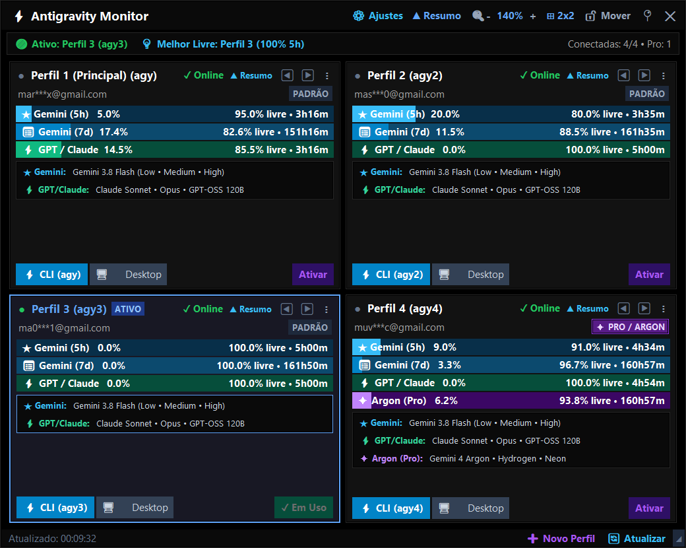
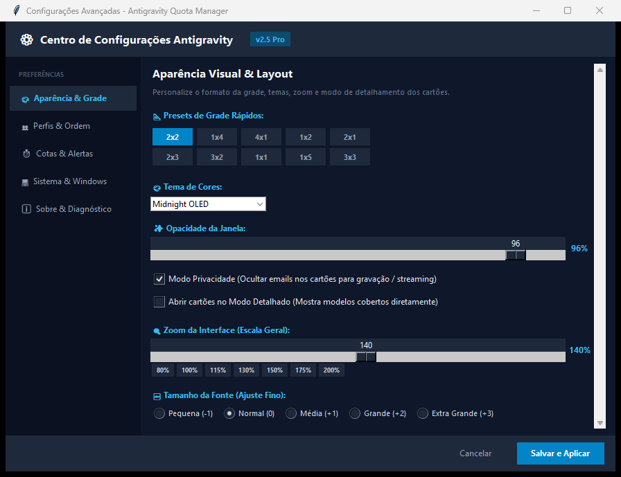

# Antigravity CLI Toolbar (`agy-cli-toolbar`)

Suíte completa em **Python Puro** para monitoramento de tokens, custos, telemetria, gerenciamento multi-conta e cotas em tempo real do **Google Antigravity (`agy`)**, oferecendo **duas experiências integradas**:

1. **Versão CLI (`statusline.py` + `agy-profile`)** — Barra de status adaptativa de 3 linhas no terminal + gerenciador de perfis e cotas via linha de comando (Windows, Linux e macOS).
2. **Versão Windows (`tray_app.pyw`)** — Dashboard flutuante na Área de Trabalho + aplicativo residente na Bandeja do Sistema (System Tray) com painel de configurações avançadas e inicialização com o Windows.

---

## 📊 Estrutura Oficial de Cotas & Modelos Suportados

O projeto espelha exatamente os pools reais reportados pela API do Google Antigravity:

| Cota / Pool | Chave na Telemetria | Modelos Exatos Cobertos | Disponibilidade |
| :--- | :--- | :--- | :--- |
| **★ Gemini (5h & 7d)** | `gemini-5h`, `gemini-weekly` | `Gemini 3.8 Flash (Low)`, `Gemini 3.8 Flash (Medium)`, `Gemini 3.8 Flash (High)` | Todos os planos |
| **⚡ GPT / Claude (Outros 3P)** | `3p-5h`, `3p-weekly` | **Padrão:** `Claude Sonnet 4.6 (Thinking)`, `Claude Opus 4.6 (Thinking)`, `GPT-OSS 120B (Medium)`<br>**Pro:** `Claude Sonnet 5.5`, `Claude Opus 5.5`, `GPT-OSS 120B (Medium)` | Todos os planos |
| **✦ Argon (WTU Weekly)** | `gemini-argon-wtu-weekly` | `Gemini 4 Argon (Low/Med/High)`, `Gemini 4 Hydrogen (Low/Med/High/XHigh)`, `Gemini 4 Neon (Low/Med/High/XHigh)`, `Orchestrator (Neon / Argon)` | **Exclusivo Plano Pro** *(oculto nos planos padrão)* |

---

## 1️⃣ Tipo 1: Versão CLI (`statusline.py` + `agy-profile`)

Ideal para quem trabalha direto no terminal (Windows Terminal, PowerShell, CMD, Bash ou Zsh) e quer telemetria completa sem sair do fluxo de código.

### 📸 Screenshots da Versão CLI

#### Barra de Status de 3 Linhas no Antigravity CLI (`statusline.py`)

> *Captura real do Google Antigravity CLI rodando com a `statusline.py` de 3 linhas ativa.*

#### Gerenciador Multi-Perfil & Cotas no Terminal (`agy-profile list`)

> *Listagem colorida dos perfis isolados, contas conectadas, barras de cota por família e modelos exatos.*

---

### 🔍 Detalhes da Arquitetura CLI

#### A. Barra de Status Adaptativa de 3 Níveis (`statusline.py`)
Construída em **Python Puro (zero dependências externas, latência < 10 ms)** com barras suaves sub-caractere (`▏`, `▎`, `▍`, `▌`, `▋`, `▊`, `▉`, `█`):

```text
[ IDLE ]  │ #29bfb6f9 "My Project" │ ✦ Gemini 3.8 Flash ⚡medium [auto] │ Tokens: [██████▍░░░░░░░░░░░░░░░░░] 26.8% (In:165.0k Out:12.4k ⚡cache:54.0k Total:177.4k/1.05M) │ Cost: $0.1399 (Saved $0.0304) │ ⏱ 45m
5h: [█████▎░░░░░░░░░░░░░░] 26% (reset 2h43m) │ 7d: [██▍░░░░░░░░░░░░░░░░░] 12% (120h) │ 🟢 Safe Pace │ 👤 user@dev.io [Pro] │ 🤖 Subagents (1): researcher │ ⚙️ Tasks:1 │ 📄 Docs:4
🧠 RAM: [████▌░░░] 56%/23G │ 🖥️ Windows │ 📁 agy-cli-toolbar │ git:main* +1-0 │ 🔌 MCP:3 active │ ⚡ Skills:8 │ 🛡️ Sandbox:ON │ 🕒 23:16:56 │ agy v1.4.12 • Py3.14
```

* **Linha 1 — Raciocínio, Modelo & Custos API:** Badge de ciclo de vida (`IDLE`, `THINKING`, `TOOL USE`), ID da conversa (`#29bfb6f9`), modelo e nível de *thinking effort*, barra de saturação de contexto de 24 blocos (com alerta `[>200k]`), custo comercial estimado em USD + economia de prompt cache, throughput em `t/s` e tempo decorrido.
* **Linha 2 — Pools de Cotas, Velocidade & Agentes:** Barras de 20 blocos para cota de **5h** e **7d**, indicador de *burn rate* (`🟢 Safe Pace` vs `🔥 Burn`), email/perfil ativo e plano, contagem de subagents em execução, tarefas assíncronas e documentos. Sincroniza automaticamente as cotas reais (`gemini-5h`, `gemini-weekly`, `3p-5h`, `gemini-argon-wtu-weekly`) no cache compartilhado `~/.antigravity-custom/profiles_quotas.json`.
* **Linha 3 — Ambiente, Workspace & Tooling:** Uso real de RAM do host, sistema operacional, diretório do projeto, branch Git com flags de modificações e commits à frente/atrás, servidores MCP ativos, skills carregadas, status do sandbox, relógio e versão do runtime.
* **Responsividade Automática:** Adapta automaticamente blocos e comprimentos de barra para terminais largos (`>= 140` colunas), médios (`100–139`) e painéis divididos estreitos (`< 100`).

#### B. Gerenciador de Perfis Isolados (`profile_manager.py` / `agy-profile`)
Permite usar várias contas Google sem conflito de sessão nem vazamento de credenciais entre perfis (`~/.agy-perfis/perfil1`, `perfil2`, ...), alternando tokens com segurança no **Windows Credential Manager** e criando atalhos CLI dedicados (`agy`, `agy2`, `agy3`, `agy4`...).

| Comando | Descrição |
| :--- | :--- |
| `agy-profile` | Abre o **Menu Interativo** colorido no terminal para gerenciar perfis |
| `agy-profile list` | Lista todos os perfis com email, status OAuth, **barras de cota (Gemini 5h/7d, Outros 3P, Argon Pro)** e modelos exatos |
| `agy-profile switch <num\|nome>` | Alterna o perfil ativo no sistema e sincroniza as credenciais |
| `agy-profile create <nome> [email]` | Cria um novo perfil isolado com `.gemini`, `settings.json` e comando `agy<N>` dedicado |
| `agy-profile auth <num\|nome>` | Autenticação **OAuth 2.0 (PKCE)** via navegador web local (porta `8085`), Desktop 1-clique ou cópia de perfil |
| `agy-profile desktop <num\|nome>` | Abre o **Antigravity Desktop** isolado (`--user-data-dir`) no perfil selecionado |
| `agy-profile run <num\|nome> [args]` | Executa o `agy` CLI isolado nas variáveis de ambiente do perfil |
| `agy-profile tray` *(ou `agy-tray`)* | Inicia a **Versão Windows** (Tray + Dashboard Widget) |
| `agy-profile autostart on\|off` | Configura inicialização silenciosa no Startup do Windows |

---

## 2️⃣ Tipo 2: Versão Windows (`tray_app.pyw` — Dashboard & Bandeja)

Aplicativo gráfico nativo para Windows (Tkinter + `pystray` + Win32 API) que roda silenciosamente em segundo plano sem janela de console (`pythonw`), oferecendo visualização simultânea de todas as suas contas Google em um **Widget Flutuante** com atualização automática.

### 📸 Screenshots da Versão Windows

#### Dashboard Flutuante — Modo Compacto (In-Bar)

> *Grade uniforme `2x2` com Faixa Executiva KPI no topo, barras compactas com percentual usado/livre e countdown embutidos, destaque do perfil ativo e ocultação automática do Argon nos planos padrão.*

#### Dashboard Flutuante — Modo Detalhado (Gavetas Expandidas)

> *Exibição expandida (`▼ Detalhes` / `▲ Resumo`) revelando os modelos exatos cobertos por cada cota diretamente nos cartões.*

#### Centro de Configurações Avançadas (`⚙️ Ajustes`)

> *Painel completo de `880x640` com rolagem em todas as 5 abas: Aparência & Grade, Perfis & Ordem, Cotas & Alertas, Sistema & Windows e Sobre & Diagnóstico.*

---

### 🔍 Detalhes da Arquitetura Windows

* **Faixa Executiva de Resumo (KPI Strip):** Mostra em tempo real o **perfil ativo**, a recomendação automática **`💡 Melhor Livre`** (clique único para trocar para a conta com mais cota disponível) e o resumo de contas conectadas e contas Pro.
* **Barras In-Bar Ultra-Compactas & Monitoramento Rápido (2s):** Observa modificações em `profiles_quotas.json` a cada **2 segundos** para refletir instantaneamente o consumo reportado pela `statusline.py`, exibindo `% usada`, `% livre` e tempo até o reset dentro da própria barra.
* **Hover Tooltips Dinâmicos & Gaveta de Modelos:**
  * Ao passar o mouse sobre qualquer barra de cota, um balão flutuante exibe os valores atuais e a lista completa de modelos exatos daquele pool.
  * O botão individual **`▼ Detalhes`** no cartão (ou **`▼ Detalhes`** global no cabeçalho) expande/recolhe a gaveta com os modelos em cada cartão.
* **Grade Rígida Simétrica & Presets Rápidos:** Uso de `uniform` grid no Tkinter garantindo que todos os cartões tenham exatamente o mesmo tamanho em qualquer layout (`1x1`, `2x2`, `1x4`, `4x1`, `2x3`, `3x2`, `3x3`, etc.), além de alça de redimensionamento livre (`◢`).
* **Menu Rápido de Contexto (`⋮` ou Botão Direito):** Acesso imediato em qualquer cartão para abrir terminal CLI (`⚡ CLI (agyN)`), abrir app Desktop (`🖥️ Desktop`), ativar perfil, renomear apelido, alternar flag de Plano Pro (Argon) ou abrir a pasta do perfil.
* **Personalização Completa:** 4 temas (`Dark Slate`, `Midnight OLED`, `Cyberpunk Neon`, `Emerald Tech`), ajuste de zoom (`75%–200%`), ajuste fino de fonte (`-1` a `+3`), controle de opacidade (`60%–100%`), Modo Privacidade (mascaramento de emails para gravações/streaming) e travamento de posição (`🔒 Fixado` / `🔓 Mover`).
* **Bandeja do Sistema (`pystray`) & Instância Única:** Controle via ícone ao lado do relógio do Windows e trava com Win32 Named Mutex + Socket IPC (`127.0.0.1:49285`) para que o atalho na Área de Trabalho traga a janela aberta para primeiro plano sem criar duplicatas.

---

## ⚖️ Comparativo Rápido: Versão CLI vs. Versão Windows

| Recurso | Versão CLI (`statusline.py` / `agy-profile`) | Versão Windows (`tray_app.pyw`) |
| :--- | :--- | :--- |
| **Onde roda** | Dentro do terminal (`agy` CLI / PowerShell / Bash) | Desktop do Windows + Bandeja do Sistema (System Tray) |
| **Compatibilidade** | Windows, Linux e macOS | Windows 10 / 11 |
| **Foco Principal** | Telemetria da sessão atual (tokens, custo USD, t/s, Git, MCP, RAM) e troca rápida via CLI | Visão consolidada multi-contas simultânea com KPIs, gráficos in-bar e clique para abrir sessões |
| **Atualização de Cotas** | Captura em tempo real direto do `stdin` do `agy` e grava em `profiles_quotas.json` | Lê `profiles_quotas.json` a cada 2s e redesenha os cartões *in-place* sem cintilação |
| **Dependências** | Python 3.8+ (biblioteca padrão apenas) | Python 3.8+, `pystray`, `Pillow`, `tkinter` |

---

## 🛠️ Instalação

### Opção 1: Instalador Automático 1-Clique (Recomendado)

#### Windows (PowerShell — instala CLI + Tray/Widget + Atalho):
```powershell
irm https://raw.githubusercontent.com/marceloasl99/agy-cli-toolbar/main/install.ps1 | iex
```

#### Linux / macOS (Bash — versão CLI):
```bash
curl -fsSL https://raw.githubusercontent.com/marceloasl99/agy-cli-toolbar/main/install.sh | bash
```

---

### Opção 2: Instalação Manual (Versão CLI)

1. Crie o diretório `~/.antigravity-custom` e copie `statusline.py` e `profile_manager.py` para ele.
2. Abra o arquivo de configuração do Antigravity CLI:
   * **Windows:** `C:\Users\<SEU_USUARIO>\.gemini\antigravity-cli\settings.json`
   * **Linux/macOS:** `~/.gemini/antigravity-cli/settings.json`
3. Adicione o bloco `statusLine`:

```json
{
  "statusLine": {
    "type": "command",
    "command": "python C:\\Users\\<SEU_USUARIO>\\.antigravity-custom\\statusline.py",
    "padding": 0,
    "stack_with_default": false,
    "enabled": true
  }
}
```

> **Flags importantes:**
> * `"padding": 0`: Elimina linhas em branco extras acima da barra de status.
> * `"stack_with_default": false`: Substitui o rodapé padrão do CLI para um visual limpo.

---

## 🎮 Uso Rápido & Inicialização

### Testar a Statusline em Sessão CLI Aberta (sem reiniciar)
```bash
/statusline python C:\Users\<SEU_USUARIO>\.antigravity-custom\statusline.py
```

### Iniciar o Dashboard Windows (Tray + Widget)
```powershell
agy-tray
```
*(Ou via `agy-profile tray` / atalho `Antigravity Quotas` na Área de Trabalho)*

---

## ⚙️ Customização da Versão CLI (`config.json`)

Personalize os módulos e o tema da barra de terminal em `~/.antigravity-custom/config.json`:

```json
{
  "theme": "default",
  "nerd_fonts": false,
  "smooth_bars": true,
  "show_line3": true,
  "show_cost": true,
  "show_tokens_per_sec": true,
  "show_quota_5h": true,
  "show_quota_weekly": true,
  "show_burn_rate": true,
  "show_subagents": true,
  "show_tasks": true,
  "show_artifacts": true,
  "show_email": true,
  "show_ram": true,
  "show_workspace": true,
  "show_git": true,
  "show_mcp": true,
  "show_skills": true,
  "show_sandbox": true,
  "show_clock": true,
  "show_version": true
}
```

### Temas Disponíveis no CLI:
* `"default"`: Cores ANSI modernas de alto contraste.
* `"tokyo_night"`: Paleta 24-bit TrueColor Tokyo Night.
* `"catppuccin"`: Paleta 24-bit TrueColor Catppuccin Mocha.
* `"nord"`: Paleta 24-bit TrueColor Nord Arctic.
* `"cyberpunk"`: Paleta 24-bit TrueColor Neon Cyberpunk.
* `"plain"`: Modo texto limpo sem preenchimento de fundo (suporta `NO_COLOR`).

---

## 🧪 Testes Automatizados

Execute a suíte de testes integrada validando o layout de 3 linhas, alertas de consumo e escala responsiva:

```bash
python tests/test_statusline.py
```

---

## 📄 Licença

MIT License. Livre para uso pessoal e comercial.
