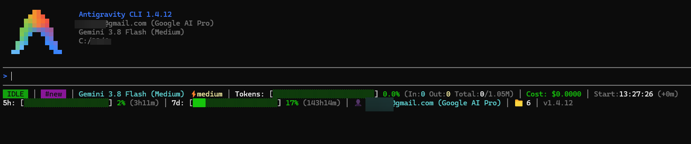
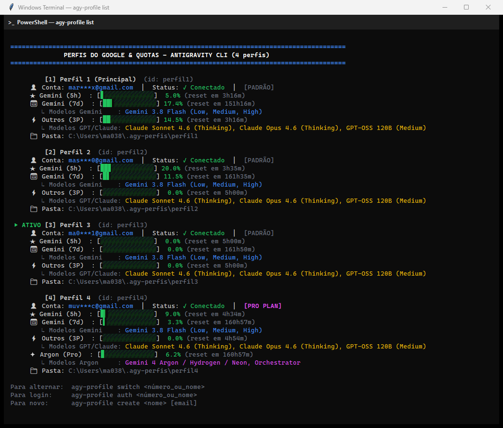
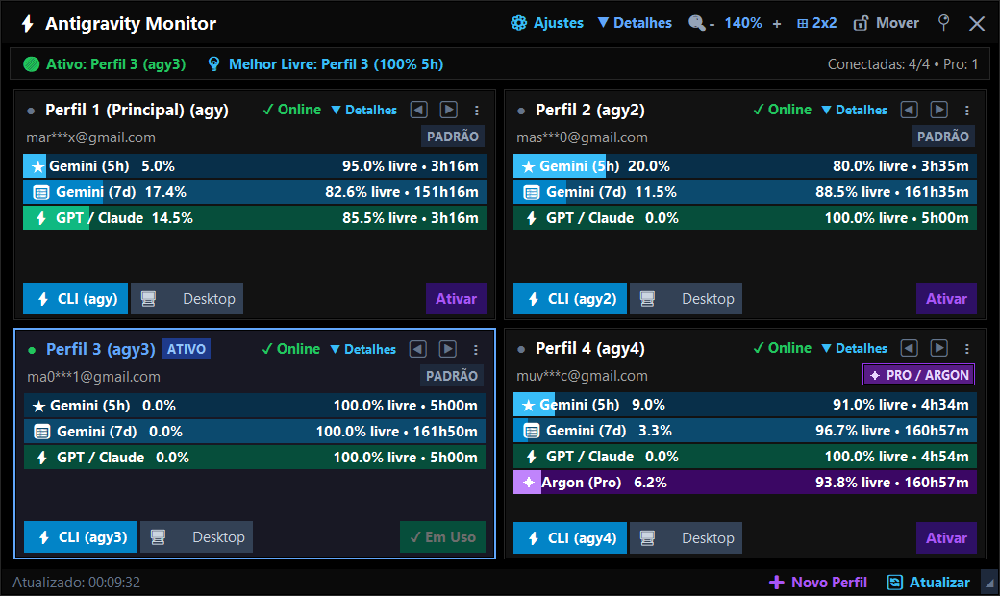
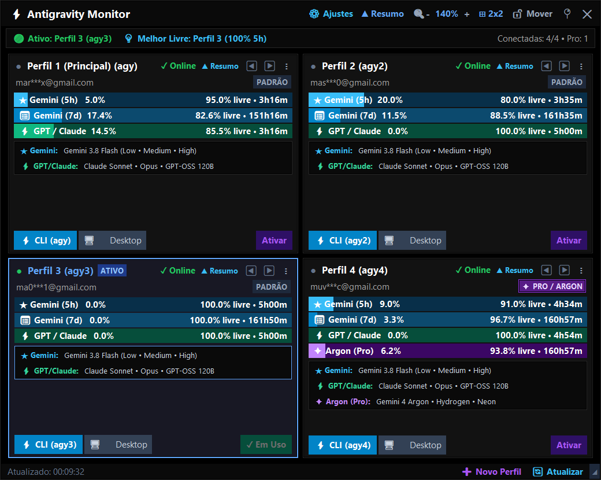
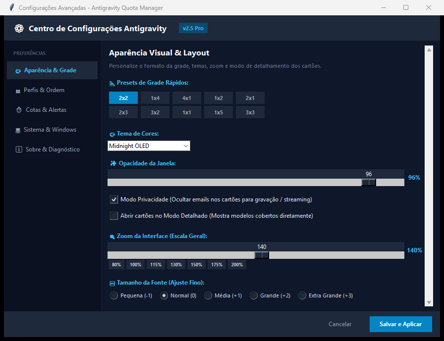

# Antigravity CLI Toolbar (`agy-cli-toolbar`)

[](https://www.python.org/)
[](LICENSE)
[](https://github.com/marceloasl99/agy-cli-toolbar)
[](https://github.com/marceloasl99/agy-cli-toolbar)

> 🇺🇸 **English Version:** For the official English documentation, please see [README.md](README.md).

Suíte completa em **Python Puro** para monitoramento de tokens, custos, telemetria em tempo real, gerenciamento multi-conta e cotas do **Google Antigravity (`agy`)**, oferecendo **duas experiências integradas**:

1. **Versão CLI (`statusline.py` + `agy-profile`)** — Barra de status executiva de **3 linhas** adaptativa no terminal com medidores suaves sub-caractere, economia de tokens e isolamento multi-perfil (Windows, Linux e macOS).
2. **Versão Windows (`tray_app.pyw`)** — Dashboard flutuante na Área de Trabalho com ajuste inteligente à tela (`Auto`, `2x2`, `3x2`), trava rígida de limites de resolução, barras embutidas com percentual livre/usado e aplicativo residente na Bandeja do Sistema (System Tray).

---

## 📊 Estrutura Oficial de Cotas & Modelos Suportados

O projeto espelha exatamente os pools reais reportados pela API e telemetria do Google Antigravity:

| Cota / Pool | Chave na Telemetria | Modelos Exatos Cobertos | Disponibilidade |
| :--- | :--- | :--- | :--- |
| **★ Gemini (5h & 7d)** | `gemini-5h`, `gemini-weekly` | `Gemini 3.8 Flash (Low)`, `Gemini 3.8 Flash (Medium)`, `Gemini 3.8 Flash (High)` | Padrão & Pro |
| **⚡ GPT / Claude (Outros 3P)** | `3p-5h`, `3p-weekly` | **Padrão:** `Claude Sonnet 4.6 (Thinking)`, `Claude Opus 4.6 (Thinking)`, `GPT-OSS 120B (Medium)`<br>**Pro:** `Claude Sonnet 5.5`, `Claude Opus 5.5`, `GPT-OSS 120B (Medium)` | Padrão & Pro |
| **✦ Argon (WTU Semanal)** | `gemini-argon-wtu-weekly` | `Gemini 4 Argon (Low/Med/High)`, `Gemini 4 Hydrogen (Low/Med/High/XHigh)`, `Gemini 4 Neon (Low/Med/High/XHigh)`, `Orchestrator (Neon / Argon)` | **Exclusivo Plano Pro** *(oculto nos planos padrão)* |

---

## 1️⃣ Versão CLI: Barra de Status Executiva de 3 Linhas

Desenvolvida em **Python Puro (zero dependências externas, latência de renderização < 10ms)** com blocos de resolução fina de 1/8 de caractere (`▏`, `▎`, `▍`, `▌`, `▋`, `▊`, `▉`, `█`).

### 📸 Capturas do Terminal

#### Barra de Status de 3 Linhas no Antigravity CLI

> *Captura real do Google Antigravity CLI com a barra de 3 linhas ativa exibindo ciclo de vida, tokens, cotas dinâmicas, subagentes e saúde do sistema.*

#### Gerenciador Multi-Perfil & Cotas no Terminal (`agy-profile list`)

> *Listagem colorida dos perfis isolados, contas conectadas, barras de cota por família de modelo e comandos dedicados.*

---

### 🔍 Arquitetura das 3 Linhas do Terminal

```text
[ IDLE ]  │ #29bfb6f9 "Meu Projeto" │ ✦ Gemini 3.8 Flash ⚡medium [auto] │ Tokens: [██████▍░░░░░░░░░░░░░░░░░] 26.8% (In:165.0k Out:12.4k ⚡cache:54.0k Total:177.4k/1.05M) │ Cost: $0.1399 (Saved $0.0304) │ ⏱ 45m
5h: [█████▎░░░░░░░░░░░░░░] 26% (reset 2h43m) │ 7d: [██▍░░░░░░░░░░░░░░░░░] 12% (120h) │ 🟢 Safe Pace │ 👤 user@dev.io [Pro] │ 🤖 Subagents (1): researcher │ ⚙️ Tasks:1 │ 📄 Docs:4
🧠 RAM: [████▌░░░] 56%/23G │ 🖥️ Windows │ 📁 agy-cli-toolbar │ git:main* +1-0 │ 🔌 MCP:3 active │ ⚡ Skills:8 │ 🛡️ Sandbox:ON │ 🕒 11:15:00 │ agy v1.4.12 • Py3.14
```

* **Linha 1 — Ciclo de Vida do Agente, Modelo & Economia de Tokens:**
  * Indicador de estado em tempo real (`IDLE`, `THINKING`, `TOOL USE`).
  * Identificador da sessão (`#29bfb6f9`) e título do projeto.
  * Modelo ativo, nível de esforço de raciocínio (`⚡low`, `⚡medium`, `⚡high`) e modo de execução (`[auto]`).
  * Barra de saturação de contexto de 24 blocos com alerta `[>200k]`.
  * Detalhamento exato de tokens: Entrada (Input), Saída (Output) e acertos de Prompt Cache.
  * Custo comercial estimado da sessão em USD + economia gerada pelo cache.
  * Velocidade de geração em tempo real (`tokens/seg`) e tempo decorrido da sessão.

* **Linha 2 — Pools de Cotas, Velocidade de Consumo & Enxame de Subagentes:**
  * Barras de cota móvel de **5 horas** e **7 dias (semanal)** com contagem regressiva exata de reset.
  * Indicador de ritmo de queima de cota (`🟢 Safe Pace` vs `🔥 Burn: X%/h`).
  * Identificador do perfil Google ativo, email autenticado e plano (`[Pro]` / `[Padrão]`).
  * Monitor do enxame de subagentes autônomos em execução (`🤖 Subagents (N)`).
  * Contador de tarefas assíncronas em background e documentos/artefatos gerados.
  * Sincronização automática das cotas para `~/.antigravity-custom/profiles_quotas.json`.

* **Linha 3 — Saúde do Sistema, Espaço de Trabalho & Ferramental:**
  * Medidor de uso de RAM do host (`🧠 RAM: [████▌░░░] 56%/23G`) via chamadas nativas sem bibliotecas pesadas.
  * Identificador do SO e pasta de trabalho ativa.
  * Status do Git: branch atual, indicador de alterações pendentes (`*`) e diff de commits (`+1-0`).
  * Contagem de servidores Model Context Protocol (MCP) ativos.
  * Skills registradas do agente Antigravity.
  * Status de proteção do sandbox (`🛡️ Sandbox:ON`).
  * Relógio local 24h e versões do runtime e motor CLI.

* **Responsividade Automática:**
  * Ajusta dinamicamente a largura das barras e textos de acordo com a largura do terminal: Largo (`>= 140` colunas), Médio (`100–139` colunas) e Compacto/Split-pane (`< 100` colunas).

---

### 👥 Gerenciador Multi-Perfil Isolado (`agy-profile`)

Isola contas Google em diretórios independentes (`~/.agy-perfis/perfil1`, `perfil2`, `perfil3`, `perfil4`, `agy5`, `agy6`...) sem conflito de credenciais nem vazamento de sessões.

> **Importante:** Use `agy1`, `agy2`, ..., `agy6` para abrir cada perfil isolado (`agy` executa o binário nativo diretamente). Como o Antigravity CLI usa um único slot no Gerenciador de Credenciais do Windows, cada perfil vincula seu e-mail esperado em `profile_identity.json` — o `pre-run` troca o token apenas para aquela identidade e o `post-run` bloqueia salvamento de conta diferente. Abrir um perfil por vez é o modo mais seguro; dois perfis diferentes abertos ao mesmo tempo compartilham esse único slot de credencial na inicialização.

| Comando | Ação |
| :--- | :--- |
| `agy-profile` | Abre o menu interativo colorido no terminal |
| `agy-profile list` | Lista todos os perfis com email, status OAuth, barras de cota e modelos cobertos |
| `agy-profile switch <num\|id>` | Alterna o perfil ativo no sistema e sincroniza as credenciais |
| `agy-profile create <nome> [email]` | Cria um novo perfil com `.gemini`, `settings.json` e comandos dedicados (`agy5`, `agy6`...) |
| `agy-profile auth <num\|id>` | Autenticação **OAuth 2.0 PKCE** no navegador ou Desktop 1-Clique |
| `agy-profile doctor [--fix]` | Audita os vínculos de conta de todos os perfis e corrige duplicidades/contaminações |
| `agy-profile reset-auth <num\|id>` | Coloca credenciais salvas do perfil em quarentena para refazer o login |
| `agy-profile bind <perfil> <email>` | Vincula manualmente um perfil ao e-mail Google esperado |
| `agy-profile capture <perfil>` | Captura a sessão ativa do Windows Credential Manager para o perfil informado |
| `agy-profile launchers` | Regera os launchers canônicos `agy1.cmd`..`agyN.cmd` e limpa atalhos antigos |
| `agy-profile desktop <num\|id>` | Abre o **Antigravity Desktop** isolado (`--user-data-dir`) para a conta selecionada |
| `agy-profile run <num\|id> [args]` | Executa o `agy` CLI nas variáveis de ambiente isoladas do perfil |
| `agy-profile delete <num\|id>` | Exclui com segurança um perfil adicional e remove seus scripts de launcher |
| `agy-profile tray` *(ou `agy-tray`)* | Inicia o Dashboard Flutuante e o ícone na Bandeja do Windows |
| `agy-profile autostart on\|off` | Configura inicialização silenciosa ao ligar o computador |

---

### 📂 Pasta de Trabalho Padrão (`agy-profile workdir`)

Cada perfil pode ter uma ou mais **pastas de trabalho confiáveis** (diretórios de projetos). Sempre que você define, adiciona ou seleciona uma pasta no seletor, ela também é gravada em `trustedWorkspaces` no `settings.json` do perfil, e o CLI entra nela automaticamente ao iniciar.

```bash
# Define a pasta padrão para um perfil (abre nela sempre que lançado)
agy-profile workdir set perfil1 C:\Projetos\meuapp

# Adiciona uma pasta extra sem mudar o padrão
agy-profile workdir add perfil1 C:\Projetos\outro

# Lista todas as pastas configuradas
agy-profile workdir list
agy-profile workdir list perfil1

# Seletor interativo — escolha qual pasta abrir
agy-profile workdir choose perfil1

# Remove uma pasta configurada
agy-profile workdir remove perfil1 C:\Projetos\outro
```

As pastas ficam salvas em `~/.antigravity-custom/profile_workdirs.json`.

---

### 🚀 Opções de Inicialização: Pasta Padrão + Permissão (`agy-profile launch`)

Antes de abrir o `agy.exe`, cada launcher (`agy1`..`agyN`) exibe um seletor rápido para confirmar ou escolher a **pasta de trabalho** e o **modo de permissão** (salvos em `~/.antigravity-custom/profile_launch.json`).

```bash
# Ver configuração de inicialização de todos os perfis (ou de um específico)
agy-profile launch show [perfil]

# Definir permissão padrão (atalho: agy-profile perm <perfil> <preset>)
agy-profile launch perm perfil1 all
agy-profile perm agy5 auto

# Ativar ou desativar o seletor ao abrir (on | off)
agy-profile launch ask perfil1 off

# Abrir o configurador interativo e salvar padrões
agy-profile launch config perfil1
```

**Presets de Permissão:**

| Preset | Descrição | Flag passada ao CLI |
| :--- | :--- | :--- |
| `default` | Padrão (pergunta antes de cada ação) | *(nenhuma)* |
| `accept-edits` | Aceitar edições automaticamente | `--mode accept-edits` |
| `auto` | Modo automático | `--mode auto` |
| `plan` | Somente planejar | `--mode plan` |
| `all` *(aliases: `todas`, `skip`)* | **Todas as permissões (sem confirmação)** | `--dangerously-skip-permissions` |
| `sandbox` | Sandbox (terminal restrito) | `--sandbox` |

**Teclas no seletor interativo:**

* `Enter` — Abrir com a pasta e permissão atuais
* `P` — Escolher pasta salva, usar pasta atual (`A`) ou digitar novo caminho (`N`)
* `M` — Escolher modo de permissão
* `S` — Salvar pasta e permissão atuais como padrão do perfil
* `D` — Não perguntar mais neste perfil (`ask_on_launch = false`) e abrir
* `0` — Cancelar abertura

> **Dica para scripts:** Defina `AGY_NO_PICKER=1` (ou passe flags diretamente como `--mode plan` / `--dangerously-skip-permissions`) para pular o seletor interativo sem alterar sua preferência salva.

**Fluxo ao abrir o perfil:**

```
agy5 ──► hook pre-run (troca credencial + seletor) ──► cd para pasta ──► agy.exe [flags] ──► hook post-run (salva com trava de identidade)
```

---

## 2️⃣ Versão Windows: Dashboard Flutuante & Bandeja do Sistema (`tray_app.pyw`)

Aplicativo nativo sem console (`pythonw.exe`) que une um **Dashboard HUD Flutuante** a um menu interativo na **Bandeja do Sistema** (`pystray`).

### 📸 Capturas da Versão Windows

#### Dashboard HUD — Modo Compacto (In-Bar)

> *Grade uniforme com Faixa Executiva KPI, barras com percentual livre/usado e tempo de reset embutidos, destaque da conta ativa e ocultação automática do Argon nos planos padrão.*

#### Dashboard HUD — Modo Detalhado (Gaveta de Modelos)

> *Exibição expandida (`▼ Detalhes`) revelando os modelos exatos cobertos por cada cota diretamente nos cartões.*

#### Centro de Configurações Avançadas (`⚙️ Ajustes`)

> *Painel completo de 880x640 com rolagem suave em todas as 5 categorias de preferências.*

---

### 🔍 Destaques da Arquitetura Windows

* **Auto-Fit Adaptativo & Clamp Rígido de Resolução:**
  * As dimensões da janela são estritamente limitadas pela resolução do seu monitor (`max_w = screen_w - 40`, `max_h = screen_h - 70`). A janela **nunca ultrapassa a tela**.
  * O botão **`⛶ Fit`** e o preset **`Auto`** recalculam dinamicamente a escala de zoom (`ui_scale`) e as dimensões para que nenhum card seja cortado ou fique fora do campo de visão.
* **Alternância Rápida: 4 Perfis (2x2) vs. Todos os Perfis (3x2):**
  * Botão direto no cabeçalho: alterne instantaneamente entre o modo clássico **`🎯 4 Perfis (2x2)`** e o modo expandido **`⊞ Todos (3x2)`** com um único clique.
* **Barras In-Bar Ultra-Compactas & Leitura Rápida (2s):**
  * Observa alterações em `profiles_quotas.json` a cada 2 segundos para refletir o consumo registrado pela `statusline.py`.
  * Mostra `% usada`, `% livre` e tempo de reset dentro da própria barra gráfica.
* **Hover Tooltips Dinâmicos:**
  * Passe o mouse sobre qualquer barra de cota para ver a lista de modelos suportados, percentual disponível e tempo de reset.
* **Faixa Executiva de Resumo (KPI Strip):**
  * Exibe o perfil ativo, total de contas conectadas, contas Pro e o atalho **`💡 Melhor Livre`** para trocar com 1 clique para a conta com mais cota disponível.
* **Menu de Contexto do Cartão (`⋮` ou Botão Direito):**
  * Ações rápidas: abrir terminal CLI (`⚡ CLI (agyN)`), abrir Desktop, alternar ativo, renomear apelido ou abrir pasta do perfil.
* **Personalização Completa:**
  * 4 temas escuros (`Dark Slate`, `Midnight OLED`, `Cyberpunk Neon`, `Emerald Tech`).
  * Controle de zoom (`75%` a `200%`), espaçamento de fontes, opacidade (`60%` a `100%`) e Modo Privacidade (mascara emails para lives/gravações).
* **Instância Única & Socket IPC:**
  * Mutex Win32 + Socket TCP local (`127.0.0.1:49285`) para trazer a janela ao topo instantaneamente sem criar processos duplicados.

---

## ⚖️ Comparativo: Versão CLI vs. Versão Windows

| Recurso | Versão CLI (`statusline.py` / `agy-profile`) | Versão Windows (`tray_app.pyw`) |
| :--- | :--- | :--- |
| **Onde Roda** | Dentro do terminal (`agy` CLI / PowerShell / Bash / Zsh) | Área de Trabalho do Windows + Bandeja do Sistema |
| **Compatibilidade** | Windows, Linux e macOS | Windows 10 / 11 |
| **Foco Principal** | Telemetria detalhada da sessão ativa (tokens, custo USD, RAM, Git) | Visão consolidada multi-contas simultânea e abertura rápida |
| **Atualização** | Lê diretamente o `stdin` da engine do Antigravity | Atualiza a cada 2s lendo `profiles_quotas.json` *in-place* |
| **Dependências** | Python 3.8+ (Biblioteca padrão apenas) | Python 3.8+, `pystray`, `Pillow`, `tkinter` |

---

## 🛠️ Instalação

### Opção 1: Instalador Automático 1-Clique (Recomendado)

#### Windows (PowerShell — Instala CLI + Versão Windows + Atalho no Desktop):
```powershell
irm https://raw.githubusercontent.com/marceloasl99/agy-cli-toolbar/main/install.ps1 | iex
```

#### Linux / macOS (Bash — Instala Versão CLI):
```bash
curl -fsSL https://raw.githubusercontent.com/marceloasl99/agy-cli-toolbar/main/install.sh | bash
```

---

### Opção 2: Instalação Manual (Versão CLI)

1. Crie o diretório `~/.antigravity-custom` e copie `statusline.py` e `profile_manager.py` para ele.
2. Abra o arquivo de configuração do Antigravity CLI:
   * **Windows:** `%USERPROFILE%\.gemini\antigravity-cli\settings.json`
   * **Linux/macOS:** `~/.gemini/antigravity-cli/settings.json`
3. Adicione o bloco `statusLine`:

```json
{
  "statusLine": {
    "type": "command",
    "command": "python ~/.antigravity-custom/statusline.py",
    "padding": 0,
    "stack_with_default": false,
    "enabled": true
  }
}
```

---

## 📄 Licença

Distribuído sob a **Licença MIT**. Gratuito para uso pessoal e comercial.
Desenvolvido para a comunidade do **Google Antigravity**.
